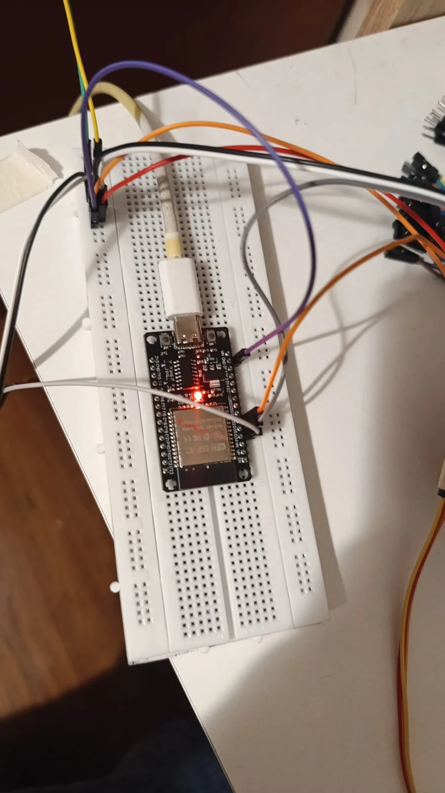
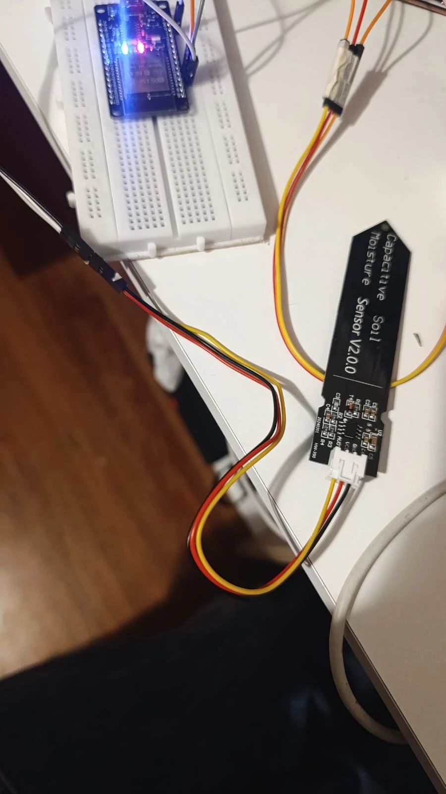

# Calibration results - esp32-01

Board: ESP32 Dev Module (CH340, COM3). Wiring: DHT22 on D32, soil sensor on D34, rain sensor on D35.
WiFi: 2.4 GHz home network. Firmware: `hardware/firmware/agrotec_node` (CALIBRATION_MODE 1 for measuring, then 0).

## Measured values (12-bit ADC, 0-4095)

| Constant | Condition | Raw value |
|---|---|---|
| `SOIL_RAW_DRY` | soil sensor in air | 4081 |
| `SOIL_RAW_WET` | tip in water up to the line | 3948 |
| `RAIN_RAW_DRY` | rain plate dry | 224 |
| `RAIN_RAW_WET` | rain plate with water drops | 3500 |

## Notes

- **Soil sensor:** the range between air and water is only ~130 counts (a working capacitive sensor
  usually drops by 1000+). The reading is near the ADC maximum in both cases, so the sensor or its
  ground/supply connection is probably faulty. The soil percentage is therefore not reliable and
  the sensor should be re-tested on a proper breadboard or soldered connections.
- **Rain sensor:** dry reading (224) is slightly above the 0-170 range in the guide but stable.
  The "wet" value was taken while the drops were still spreading (readings 3500-4000).
- **DHT22:** air temperature ~22.9 C and humidity ~66 % read correctly.

## Verification

- Serial Monitor: `WiFi connected` and `POST https://agrotec-ten.vercel.app/api/readings -> 201`.
- `/api/readings/latest` returns `device_id: esp32-01` and `"online": true`.

## Wiring photo

