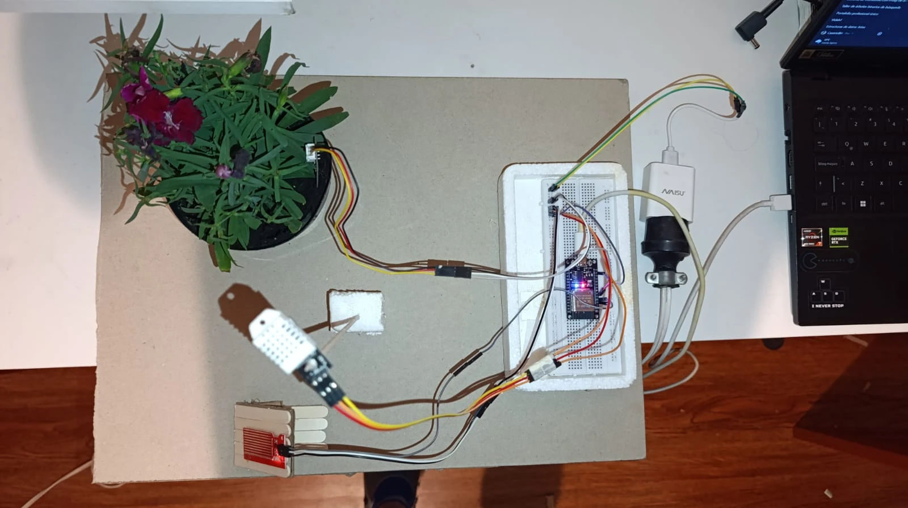
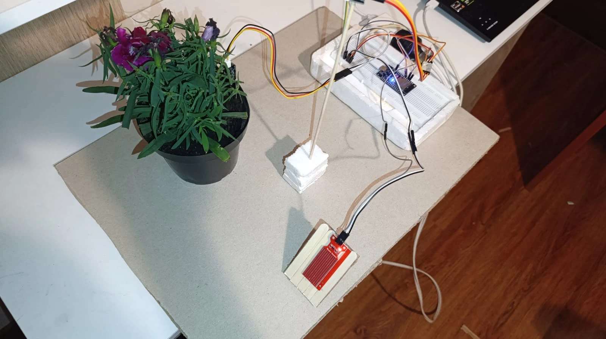

# AgroTec - Demo checklist (maqueta física)

Nodo: `esp32-01` (ESP32 Dev Module). Cableado fijo: DHT22 en D32, suelo en D34, lluvia en D35.
App: selector **Sensor real (ESP32)** (el modo "Simulado" no usa la placa).
pH y UV salen como **SIM**: están simulados (no hay sensores conectados).

## Antes de la demo

- [ ] Base (~40x30 cm), matera con tierra y planta al centro.
- [ ] Sensor de suelo clavado a ~5 cm de la planta, SOLO hasta la línea impresa; borde superior sellado.
- [ ] DHT22 en un palito a ~20 cm sobre la planta, a la sombra.
- [ ] Placa roja de lluvia en una esquina, inclinada para que el agua escurra.
- [ ] ESP32 dentro de la caja plástica, lejos del agua, con el USB saliendo por un orificio.
- [ ] Todo fijado con silicona o cinta. Letrero "AgroTec - Nariño".
- [ ] Alimentación con power bank (o cargador USB).
- [ ] La zona WiFi (2.4 GHz) está encendida y la placa queda cerca del router.
- [ ] Abrir la app en modo **Sensor real (ESP32)** y ver "Nodo esp32-01 en línea".

## Reglas de seguridad

- Nunca mojar la placa, el shield ni los cables. Solo se mojan la punta del sensor de suelo y la placa roja de lluvia.
- No mover los cables de la placa sin avisar a Brayan (pines específicos: D32, D34, D35).

## Guion ensayado (resultado esperado y estado de la prueba)

| # | Acción | Resultado esperado en la app | Prueba |
|---|---|---|---|
| 1 | Abrir la app y elegir "Sensor real (ESP32)" | Aviso verde "Nodo esp32-01 en línea · hace N s"; temperatura y humedad del suelo con etiqueta REAL | OK |
| 2 | Respirar cerca del DHT22 | Sube la temperatura (~+2 C) y la humedad del aire llega a ~100 % | OK (21.6 -> 23.5 C, humedad 100 %) |
| 3 | Gotas en la placa roja | Sube la lluvia | OK (de ~5 % a ~90 % con gotas) |
| 4 | Echar agua a la matera | Debería subir la humedad del suelo | **Pendiente**: ver nota del sensor de suelo |
| 5 | Dejar secar | Baja y puede aparecer una alerta | **Pendiente** (depende del punto 4) |
| 6 | Pulsar "Analizar mi cultivo" | La IA explica con las lecturas actuales | OK, pero tarda 25-60 s (ver notas) |
| 7 | Apagar el ESP32 | A los ~30 s la app dice "Nodo sin señal" | OK |

## Notas y límites conocidos

- **Sensor de suelo:** en la calibración el rango entre aire (4081) y agua (3948) fue de solo ~130 cuentas
  (un sensor capacitivo sano baja 1000+). El porcentaje de suelo es poco fiable y la app puede mostrar
  una alerta de humedad "ALTO" con 0 %. Antes de la demo conviene revisar el contacto del cable de señal
  (D34) y recalibrar con la matera real.
- **"Analizar mi cultivo" (ensayado):** el botón pasa a "Pensando..." y Gemini responde en 25-60 s. Resultado real
  del ensayo (cultivo Papa, modo Sensor real): riesgo **BAJO**, riego **NINGUNO**, mensaje "Alta probabilidad de
  lluvia: vigile encharcamiento y hongos" y un consejo de revisar drenajes y vigilar hongos (gota/tizón), con la
  humedad del suelo real en 44 %. Durante la demo, pulsar el botón con tiempo y seguir hablando mientras responde.
  El pH y la UV que usa la IA son simulados.
- **Alertas de lluvia:** con la placa de lluvia mojada la app lee 100 % y la cola de alertas acumula avisos
  "Prob. de lluvia - ALTO" en cada lectura (llegó a 5 pendientes). Secar la placa antes de empezar y usar
  "Restablecer datos guardados" para limpiar la cola entre ensayos.
- **Envío intermitente:** algunos POST fallan (`-1`, `-11`), sobre todo con señal WiFi débil. Si la app
  marca "sin señal" un momento, esperar unos segundos. Mantener la placa cerca del router.
- **Aviso "sin señal":** aparece cuando pasan ~30 s sin lectura, tanto al apagar la placa como si fallan los envíos.
- No subir `config.h` (contiene claves).

## Fotos de la maqueta

Vista superior (matera con el sensor de suelo, DHT22 en palito sobre base de icopor, placa roja de lluvia
sobre palitos, ESP32 en protoboard sobre una bandeja de icopor, alimentada por cargador USB):

Vista lateral:

Pendiente de mejorar antes de la demo final: la ESP32 está sobre la protoboard en una bandeja abierta
(no dentro de la caja plástica) y la placa de lluvia está plana (inclinarla para que el agua escurra).
